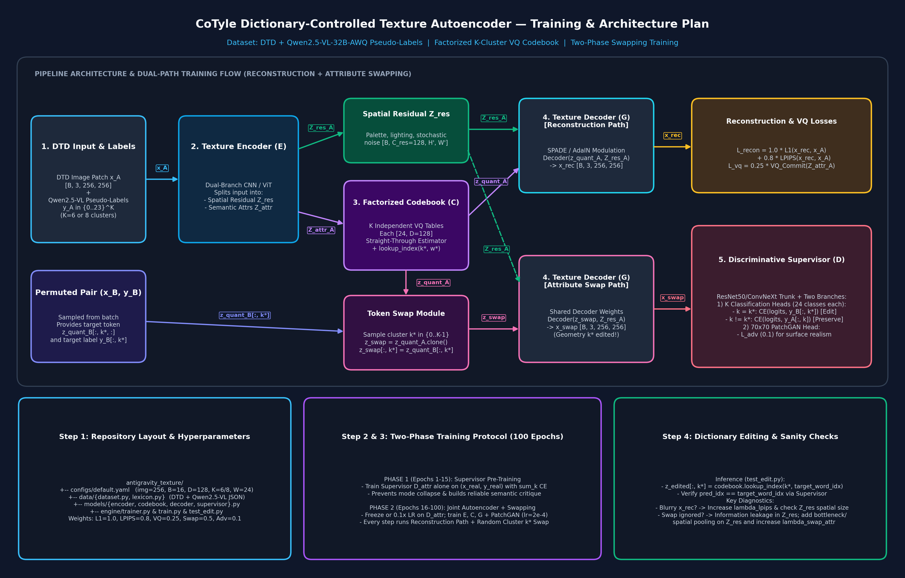

# CoTyle Dictionary-Controlled Texture Autoencoder — Implementation & Training Plan



## 1. Pipeline Architecture Overview

The system disentangles structural/semantic texture attributes from stochastic residual appearance using four primary modules:

1. **Texture Encoder ($E$):** Dual-branch CNN/ViT backbone that maps an input texture image $x \in \mathbb{R}^{B \times 3 \times 256 \times 256}$ into:
   - **Spatial Residual Map ($Z_{\text{res}} \in \mathbb{R}^{B \times C_{\text{res}} \times H' \times W'}$):** Captures palette, lighting, and fine stochastic surface noise. Equipped with a channel/spatial bottleneck to prevent structural geometry leakage.
   - **Semantic Attribute Vectors ($Z_{\text{attr}} \in \mathbb{R}^{B \times K \times D}$):** $K$ continuous attribute embeddings (one per semantic cluster).
2. **Factorized Codebook ($\mathcal{C}$):** $K$ independent vector-quantization (VQ) lookup tables, each of shape `[24, D]`. Performs straight-through quantization during reconstruction and hard dictionary token substitution (`lookup_index(k*, w*)`) during controllable texture editing.
3. **Texture Decoder ($G$):** SPADE / AdaIN-modulated generator that synthesizes RGB textures from $Z_{\text{res}}$ modulated by the quantized attribute tokens $Z_{\text{quant}}$.
4. **Discriminative Supervisor ($D$):** Shared convolutional trunk (e.g., ResNet-50 / ConvNeXt) branching into:
   - **$K$ Multi-Class Classification Heads** (24 logits per head) supervising semantic attribute fidelity on both real and attribute-swapped textures.
   - **$70 \times 70$ PatchGAN Discriminator Head** enforcing high-frequency surface realism.

---

## 2. Dataset & Pseudo-Labels Integration

- **Source Archive / Directory:** `~/Downloads/dtd-pseudo-labled-Qwen2.5-VL-32B-AWQ-20261103T120624Z-1-001`
- **Target Workspace Data Path:** `antigravity_texture/dtd/` (`images/` + `dtd_pseudo_labels.json`)
- **Cluster Configuration:**
  - $K = 6$ structural/surface clusters (or $K = 8$ when including `chromatic_quality` and `hue` from the Qwen2.5-VL-32B-AWQ annotations).
  - 24 lexicon words per cluster (`words_per_cluster: 24`).

---

## 3. Repository Structure & Configuration

```text
antigravity_texture/
├── configs/
│   └── default.yaml          # Hyperparameters, paths, loss weights
├── data/
│   ├── dataset.py            # DTD loader paired with Qwen2.5-VL pseudo-labels JSON
│   └── lexicon.py            # CLUSTER_ORDER, CLUSTER_LEXICON definitions
├── models/
│   ├── encoder.py            # Dual-branch CNN/ViT (z_attr, z_res)
│   ├── codebook.py           # Factorized K-table VQ module with EMA / straight-through
│   ├── decoder.py            # SPADE/AdaIN-conditioned generator
│   └── supervisor.py         # Multi-head attribute classifier & 70x70 PatchGAN
├── engine/
│   └── trainer.py            # Two-phase training loop (Supervisor pretrain + Swap training)
├── train.py                  # Training CLI entry point
└── test_edit.py              # Single-attribute dictionary swap & verification script
```

### `configs/default.yaml`

```yaml
data:
  img_dir: "dtd/images"
  labels_json: "dtd/dtd_pseudo_labels.json"
  img_size: 256
  batch_size: 16
  num_workers: 4

model:
  latent_dim: 128
  res_channels: 128
  num_clusters: 6           # Set to 8 if including chromatic_quality & hue
  words_per_cluster: 24

loss_weights:
  recon_l1: 1.0
  recon_lpips: 0.8
  vq: 0.25
  swap_attr: 0.5
  adv_patch: 0.1

optim:
  lr_g: 0.0002
  lr_d: 0.0002
  beta1: 0.5
  beta2: 0.999
  pretrain_epochs: 15
  max_epochs: 100
```

---

## 4. Module Specifications

### 4.1 Data Loader (`data/dataset.py` & `data/lexicon.py`)
- Parses `dtd_pseudo_labels.json` and filters for entries containing valid lexicon tokens across all $K$ clusters in `CLUSTER_ORDER`.
- Maps each string label `v[c]` to its integer index $y_k \in \{0, \dots, 23\}$ via `self.w2i[c][v[c]]`.
- Applies `Resize(256, 256)`, random horizontal/vertical flips, and `[-1, 1]` normalization.

### 4.2 Factorized Codebook (`models/codebook.py`)
- Holds `nn.ModuleList` of $K$ embedding tables `nn.Embedding(24, D)`.
- **Forward pass:** For each cluster $k \in \{0, \dots, K-1\}$, computes nearest neighbor distances between $z_{\text{attr}}[:, k, :]$ and table $\mathcal{C}_k$, applies the straight-through estimator:
  $$z_{\text{quant}} = z_{\text{attr}} + \text{sg}(e_{k, i^*} - z_{\text{attr}})$$
  and returns commitment + codebook loss $\mathcal{L}_{\text{vq}} = \| \text{sg}(z_{\text{attr}}) - e \|_2^2 + \beta \| z_{\text{attr}} - \text{sg}(e) \|_2^2$.
- **Supervised Codebook Alignment (Optional / Recommended):** Since each sample has ground-truth pseudo-label indices $y_A \in \{0, \dots, 23\}^K$, codebook entry $e_{k, y_{A,k}}$ can either be directly indexed during supervised warm-up or aligned via an auxiliary cross-entropy distance loss on $-\|z_{\text{attr}}[:, k, :] - \mathcal{C}_k\|_2^2$ so that word index $w$ in table $k$ directly corresponds to lexicon word $w$.
- **Editing API:** `lookup_index(cluster_idx, word_idx)` returns $\mathcal{C}_{\text{cluster\_idx}}(\text{word\_idx})$ for direct token substitution.

### 4.3 Texture Encoder & Decoder (`models/encoder.py`, `models/decoder.py`)
- **Encoder ($E$):** Shared stem downsampling $256 \to 32$, splitting into:
  - Residual head producing $Z_{\text{res}} \in \mathbb{R}^{B \times 128 \times 32 \times 32}$ (with optional spatial dropout / instance normalization to strip global semantic layout).
  - Attribute head applying global average pooling + $K$ linear projections to produce $Z_{\text{attr}} \in \mathbb{R}^{B \times K \times 128}$.
- **Decoder ($G$):** Concatenates/projects the $K$ quantized tokens $Z_{\text{quant}} \in \mathbb{R}^{B \times (K \cdot D)}$ into a style vector that modulates residual blocks via AdaIN/SPADE across upsampling stages $32 \to 64 \to 128 \to 256$.

### 4.4 Discriminative Supervisor (`models/supervisor.py`)
- **Attribute Trunk & Heads ($D_{\text{attr}}$):** ResNet-50 / ConvNeXt feature extractor followed by $K$ linear classification heads (`nn.Linear(feat_dim, 24)`).
- **PatchGAN Discriminator ($D_{\text{patch}}$):** 4-layer $70 \times 70$ PatchGAN operating on real vs. decoded/swapped images with hinge or LSGAN loss.

---

## 5. Multi-Stage Training Protocol (`engine/trainer.py`)

### Phase 1: Supervisor Pre-training (Epochs 1–15)
Train $D_{\text{attr}}$ exclusively on real DTD images and Qwen2.5-VL pseudo-labels:
$$\mathcal{L}_{\text{sup\_init}} = \sum_{k=1}^K \text{CrossEntropy}\big(D_{\text{attr}}^{(k)}(x_{\text{real}}),\, y_k^{\text{real}}\big)$$
- **Goal:** Establish a high-accuracy, calibrated multi-attribute evaluator before training the generator.
- **Validation Gate:** Log per-cluster top-1 and top-3 accuracy on a held-out validation split at Epoch 15.

### Phase 2: Joint Autoencoder + Attribute Swapping (Epochs 16–100)
Freeze $D_{\text{attr}}$ (or fine-tune at $0.1 \times \text{lr}$) and jointly optimize $(E, \mathcal{C}, G)$ and $D_{\text{patch}}$:

1. **Encode & Quantize:**
   $$(Z_{\text{attr}, A}, Z_{\text{res}, A}) = E(x_A), \quad (Z_{\text{quant}, A}, \text{idx}_A, \mathcal{L}_{\text{vq}}) = \mathcal{C}(Z_{\text{attr}, A})$$
2. **Reconstruction Path:**
   $$\hat{x}_{\text{rec}} = G(Z_{\text{quant}, A}, Z_{\text{res}, A})$$
   $$\mathcal{L}_{\text{recon}} = \lambda_{\text{L1}} \|\hat{x}_{\text{rec}} - x_A\|_1 + \lambda_{\text{LPIPS}} \, \text{LPIPS}(\hat{x}_{\text{rec}}, x_A)$$
3. **Attribute Swapping Path:**
   - Permute batch to obtain pair $(x_B, y_B)$ and quantized tokens $Z_{\text{quant}, B}$.
   - Sample random target cluster $k^* \in \{0, \dots, K-1\}$.
   - Construct swapped latent:
     $$Z_{\text{swap}} = Z_{\text{quant}, A}.\text{clone}(), \quad Z_{\text{swap}}[:, k^*, :] = Z_{\text{quant}, B}[:, k^*, :]$$
   - Decode edited texture: $\hat{x}_{\text{swap}} = G(Z_{\text{swap}}, Z_{\text{res}, A})$.
4. **Supervisor & Adversarial Losses:**
   - Evaluate $\hat{x}_{\text{swap}}$ through $D_{\text{attr}}$ and $D_{\text{patch}}$:
     $$\mathcal{L}_{\text{swap\_attr}} = \text{CE}\big(D_{\text{attr}}^{(k^*)}(\hat{x}_{\text{swap}}),\, y_B^{(k^*)}\big) + \sum_{k \neq k^*} \text{CE}\big(D_{\text{attr}}^{(k)}(\hat{x}_{\text{swap}}),\, y_A^{(k)}\big)$$
   - Compute PatchGAN adversarial loss $\mathcal{L}_{\text{adv}}$ on $\hat{x}_{\text{rec}}$ and $\hat{x}_{\text{swap}}$.
5. **Total Generator Objective:**
   $$\mathcal{L}_G = \mathcal{L}_{\text{recon}} + \lambda_{\text{vq}}\mathcal{L}_{\text{vq}} + \lambda_{\text{swap}}\mathcal{L}_{\text{swap\_attr}} + \lambda_{\text{adv}}\mathcal{L}_{\text{adv}}$$

---

## 6. Verification, Inference & Diagnostic Checklist

1. **Single-Attribute Editing Script (`test_edit.py`):**
   - Encodes a test image, replaces cluster $k^*$ with `codebook.lookup_index(k*, target_word_idx)`, decodes the edited texture, and checks whether $\arg\max D_{\text{attr}}^{(k^*)}(\hat{x}_{\text{edit}}) == \text{target\_word\_idx}$.
2. **Reconstruction Sharpness Check:**
   - Compare $\hat{x}_{\text{rec}}$ vs. $x_{\text{real}}$ every 5 epochs. If textures appear overly smooth, increase $\lambda_{\text{lpips}}$ or increase spatial dimensions of $Z_{\text{res}}$.
3. **Information Leakage Check:**
   - If swapping cluster $k^*$ fails to alter the target geometry while $\hat{x}_{\text{rec}}$ looks identical to $x_A$, $Z_{\text{res}}$ is carrying too much structural information. Mitigate by narrowing `res_channels`, applying InstanceNorm + spatial bottleneck on $Z_{\text{res}}$, and raising $\lambda_{\text{swap\_attr}}$.

